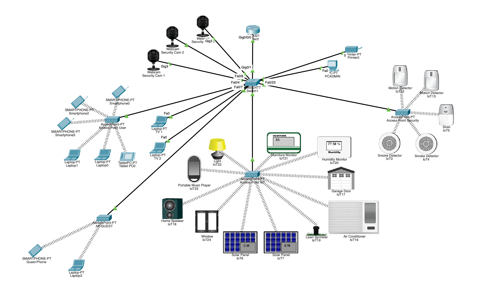

# Smart-home-packet-tracer-lab
Smart Home Enterprise-Grade Network &amp; Security Architecture - Packet Tracer Lab

# 🏡 Smart Home Network & Security Architecture

---

## 📌 Objectif du projet

Conception et sécurisation d'une architecture réseau segmentée pour une résidence connectée haut de gamme sous **Cisco Packet Tracer**. Ce projet met en œuvre un routage inter-VLAN en mode **Router-on-a-Stick**, un cloisonnement strict des flux domotiques et de sécurité par **ACLs étendues**, ainsi qu'un durcissement complet des équipements actifs.

---

## 🗺️ Topologie & Plan d'Adressage

- **1 Routeur** : configuré en Router-on-a-Stick (`GigabitEthernet0/0/0`) avec sous-interfaces 802.1Q, serveur DHCP intégré et filtrage par ACLs étendues.
- **1 Switch** : configuré avec ports d'accès sécurisés, liaison Trunk filtrée et interface virtuelle de management (SVI).

### 🌐 Plan d'adressage (6 VLANs)

- **VLAN 10 (ADMIN)** : `192.168.10.0/24` (Passerelle : `192.168.10.1`) — Supervision, administration SSH/Console et gestion du switch (`192.168.10.2`).
- **VLAN 20 (SECURITY)** : `192.168.20.0/24` (Passerelle : `192.168.20.1`) — Caméras IP, enregistreurs et contrôle d'accès.
- **VLAN 30 (IOT)** : `192.168.30.0/24` (Passerelle : `192.168.30.1`) — Objets connectés et équipements domotiques (isolés).
- **VLAN 40 (USER)** : `192.168.40.0/24` (Passerelle : `192.168.40.1`) — Postes résidents, multimédia et terminaux personnels.
- **VLAN 50 (GUEST)** : `192.168.50.0/24` (Passerelle : `192.168.50.1`) — Accès invités / prestataires, totalement étanche vis-à-vis du LAN interne.
- **VLAN 999 (NATIVE / BLACKHOLE)** : VLAN natif sur le trunk et affectation des ports inutilisés du switch.

---

---

## 🔒 Technologies & Sécurité Implémentées

- **Routage Inter-VLAN & DHCP** : encapsulation IEEE 802.1Q et attribution dynamique d'IP par pool VLAN avec exclusion des adresses d'infrastructure.
- **Filtrage & Cloisonnement (ACLs)** : ACLs étendues appliquées en entrée (`in`) sur chaque sous-interface pour isoler les flux IoT et Invités et protéger le réseau Admin.
- **Durcissement des Accès (Hardening)** : authentification locale (`login local`), chiffrement des secrets (`enable secret`), accès distant limité à **SSH v2** (clés RSA 1024 bits), et verrouillage de toutes les lignes `vty 0 15` ainsi que de la console physique (`line con 0`).
- **Sécurité Couche 2 (Switching)** : désactivation de DTP (`switchport nonegotiate`), activation de `spanning-tree portfast` sur les ports d'accès, filtrage des VLANs autorisés sur le trunk (`10,20,30,40,50,999`) et neutralisation des ports vacants dans le VLAN 999.

---

## ⚖️ Compromis de Simulation (Packet Tracer vs Réalité Terrain)

Ce projet a nécessité plusieurs adaptations techniques par rapport à une installation domotique haut de gamme réelle :

- **Multiplication des Access Points (AP) & limites des WLANs** : Packet Tracer gère de façon limitée la multiplication de WLANs/SSIDs mappés à différents VLANs sur un même point d'accès ainsi que la gestion centralisée. Il a donc fallu multiplier les AP plutôt que de s'appuyer sur un contrôleur Wi-Fi type WLC.
- **Équipements IoT en Wi-Fi au lieu du filaire (Ethernet / bus KNX)** : par contrainte de simulation, des équipements du VLAN 30 (`IOT`) sont rattachés en sans-fil/IP. Dans une maison connectée haut de gamme réelle, la majorité des organes fixes et critiques (éclairages, volets, capteurs, automatismes) passeraient par du **câblage filaire dédié** — notamment un **bus KNX** (via passerelle IP/KNX sécurisée) ou de l'**Ethernet filaire (PoE)** — le Wi-Fi étant réservé aux équipements mobiles.
- **Pare-feu & Haute Disponibilité** : en production, les ACLs du routeur seraient complétées par un pare-feu dédié (inspection applicative) et une redondance matérielle/électrique adaptée aux systèmes critiques.

---

## 📂 Organisation du Dépôt

Le dossier `configs/` contient les configurations brutes extraites des équipements :

- [Configuration du routeur](./configs/Router.cfg)
- [Configuration du switch](./configs/Switch1.cfg)

[Fichier Packet Tracer](projet-maison-connectée.pkt)
